# Employee Attendance & Analytics API

FastAPI + MongoDB backend for punch-in / punch-out with business rules, manual corrections with an audit trail, and
analytics built on MongoDB aggregation pipelines. A small **optional** React dashboard (`frontend/`) sits on top of it.

* **Backend:** Python 3.11+, FastAPI, PyMongo, MongoDB 6.0+ (tested on 7.0). **All API code is in one file: `app/main.py`.**
* **Frontend (optional, not part of the assignment contract):** React 18 + Vite + Recharts. Delete `frontend/` if you only want the API.
* **Status: everything in the contract is implemented.** Nothing is missing (see [what is covered](#whats-covered)).

---

## Table of contents
1. [Quick start (VS Code)](#1-quick-start-vs-code)
2. [Architecture](#2-architecture)
3. [Flow charts](#3-flow-charts)
4. [Data model](#4-data-model)
5. [Analytics pipelines](#5-analytics-pipelines)
6. [API reference](#6-api-reference)
7. [Business rules](#7-business-rules-r1r10)
8. [Indexes](#8-indexes)
9. [Testing](#9-testing)
10. [Project layout](#10-project-layout)
11. [What's covered / notes](#whats-covered)

> Diagrams are written in [Mermaid](https://mermaid.js.org/): GitHub renders them automatically. In VS Code install
> the extension **Markdown Preview Mermaid Support** (`bierner.markdown-mermaid`) and open the preview with `Ctrl+Shift+V`.
> Pre-rendered PNG copies are in [`docs/diagrams/`](docs/diagrams) if you would rather just open an image.


---

## 1. Quick start (VS Code)

**Prerequisites:** Python 3.11+, Git, MongoDB 6.0+ (any one of the three options below), Node.js 18+ (only for the dashboard).

### Step 1: get a MongoDB

| Option | Command / action |
|---|---|
| Docker (easiest) | `docker run -d --name attendance-mongo -p 27017:27017 mongo:7` |
| MongoDB Atlas (free M0) | Create a cluster, add your IP, copy the `mongodb+srv://...` string into `MONGO_URI` |
| Local install | Install MongoDB Community Server and start the `mongod` service |

### Step 2: backend

Open the extracted folder in VS Code (`File > Open Folder`), open the integrated terminal (`` Ctrl+` ``) and run:

**Windows (PowerShell)**
```powershell
python -m venv .venv
.venv\Scripts\Activate.ps1          # if blocked: Set-ExecutionPolicy -Scope CurrentUser RemoteSigned
pip install -r requirements.txt
copy .env.example .env              # edit MONGO_URI / MONGO_DB if you are not using local defaults
python scripts/seed_demo.py         # optional: demo data (40 employees, ~90 days)
uvicorn app.main:app --port 8000 --reload
```

**macOS / Linux**
```bash
python3 -m venv .venv && source .venv/bin/activate
pip install -r requirements.txt
cp .env.example .env
python scripts/seed_demo.py         # optional: demo data
uvicorn app.main:app --port 8000 --reload
```

Then open **http://localhost:8000/docs** (Swagger UI) or `http://localhost:8000/health`.
Indexes are created automatically at startup, no manual step.
In VS Code you can also press `F5` (config in `.vscode/launch.json`) and pick the interpreter from `.venv`
(`Ctrl+Shift+P` > *Python: Select Interpreter*).

### Step 3: dashboard (optional)

In a **second** terminal:
```bash
cd frontend
npm install
npm run dev                          # http://localhost:5173  (proxies /api to the backend on :8000)
```
If the demo data is stale (dates are generated relative to *today*) just run `python scripts/seed_demo.py` again.

### Configuration

| Variable | Default | Meaning |
|---|---|---|
| `MONGO_URI` | `mongodb://localhost:27017` | MongoDB connection string. Real environment variables win over `.env`. |
| `MONGO_DB` | `attendance_db` | Database name. |
| `CORS_ORIGINS` | `http://localhost:5173,http://127.0.0.1:5173` | Only used if the dashboard calls the API directly instead of through the Vite proxy. |

---

## 2. Architecture

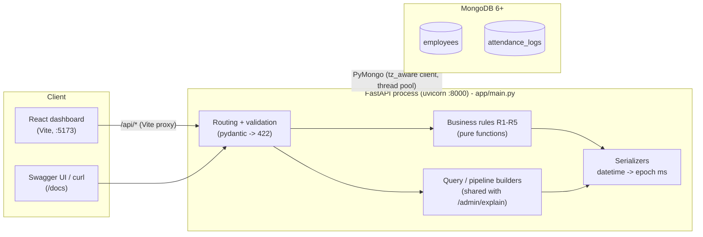

**How the single file is organised** (top to bottom, each section only depends on the ones above it):

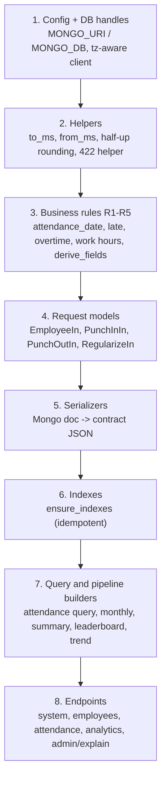

Key design choices:

* **MongoDB enforces the invariants, not Python.** "One record per employee per day" and "unique `emp_code`" are unique indexes; the
  loser of a race gets `DuplicateKeyError` -> 409. Punch-out and corrections use conditional atomic updates (`find_one_and_update`).
* **Instants are UTC `datetime`s inside, epoch milliseconds at the edge.** The client is `tz_aware=True`; conversion happens only in
  `to_ms()` / `from_ms()`. Calendar dates and shift times stay strings (`YYYY-MM-DD`, `HH:MM`), as stored.
* **Derived fields are stored and read back** (`work_hours`, `late_minutes`, `overtime_minutes`, `half_day`). They are computed in one
  function (`derive_fields`) used by punch-in, punch-out and the PATCH correction, so they can never disagree.
* **Analytics are aggregation pipelines**, not Python loops. The same builder function is used by the real endpoint and by
  `/admin/explain/{endpoint}`, so the explained plan is the real plan.
* **Rounding is half-up everywhere** (Decimal in Python, decimal128 arithmetic inside the pipelines) because Python's `round()` and
  MongoDB's `$round` are both banker's rounding.

---

## 3. Flow charts

### Punch-in

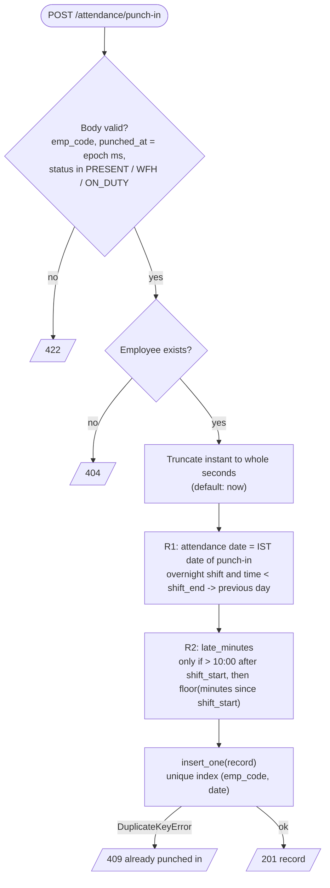

### Punch-out

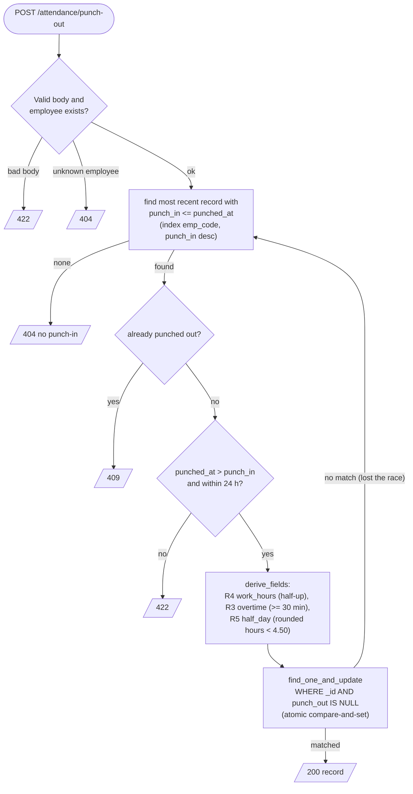

### Regularization (manual correction) with audit trail

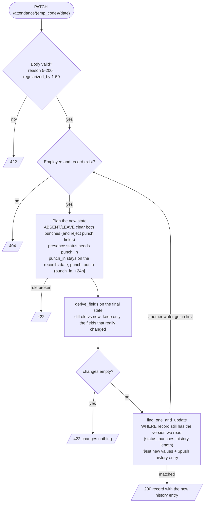

The history array is append-only, so its **length is the version number**. A concurrent correction makes the filter miss, the loser re-reads and
re-plans against the newer record and appends its own entry: no history entry is ever overwritten.

### Why parallel punch-ins produce exactly one 201

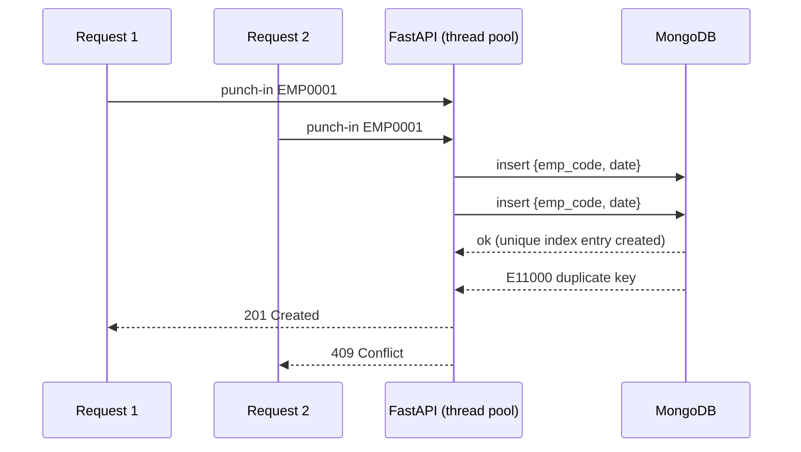

---

## 4. Data model

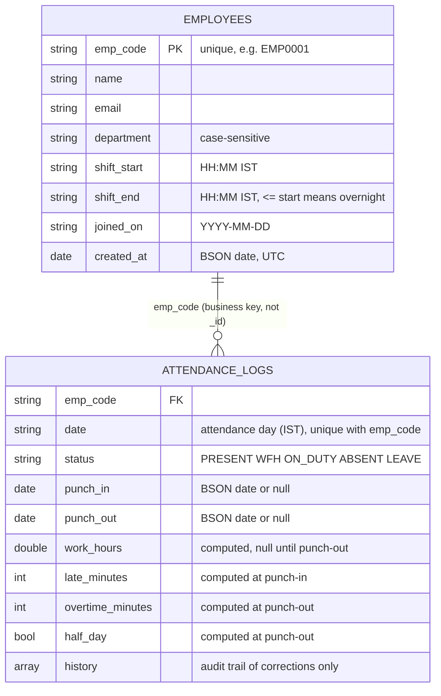

A `history` entry: `{ at, by, reason, changes: { <field>: { from, to } } }`, where `changes` holds only the fields that actually changed.
In MongoDB the times are BSON dates; in the API every instant is an integer in **epoch milliseconds**.

---

## 5. Analytics pipelines

All four analytics endpoints are single aggregation pipelines. Money-shot decisions are in [DECISIONS.md](DECISIONS.md).

### Employee monthly: `GET /analytics/employees/{emp_code}/monthly?month=YYYY-MM`
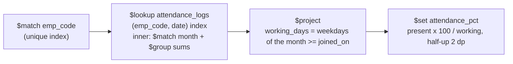

### Department summary: `GET /analytics/departments/summary?month=...`
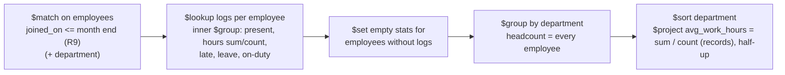
Starting from `employees` is what guarantees that people with **zero logs are counted** and people who **join later are not**. The average
is `sum(work_hours) / count(records with work_hours)` across the whole department, not an average of per-employee averages.

### Late leaderboard: `GET /analytics/leaderboard/late?month=...&limit=...&department=...`
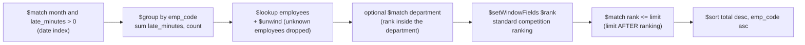
Example with `limit=3` and totals 100, 80, 80, 80, 50: ranks are 1, 2, 2, 2, 5 -> **four rows** are returned because the tie at rank 2 is entirely `<= 3`.

### Department trend: `GET /analytics/departments/{department}/trend?from=...&to=...`
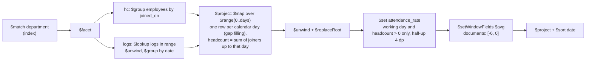
The 7-day window is **row based** over the filled range, so the first rows naturally use a shorter window and rows before `from` are never
considered. A day with no records at all still has a row (`attendance_rate: 0.0` on a working day, `null` on a weekend).
`moving_avg_7d` averages the already-rounded `attendance_rate` values that are shown in the response.

### Explain: `GET /admin/explain/{endpoint}`
`attendance_list`, `employee_monthly`, `department_summary`, `late_leaderboard`, `department_trend`. It calls the **same builder function** as the real
endpoint and runs `explain` with `executionStats`. On a 72k-record dataset every plan is an `IXSCAN` with no `COLLSCAN`.

---

## 6. API reference

Interactive docs: `http://localhost:8000/docs`. Errors use FastAPI's `{"detail": ...}`.

| Method | Path | Notes | Codes |
|---|---|---|---|
| GET | `/health` | pings MongoDB | 200 / 503 |
| POST | `/employees` | unique `emp_code` (`EMP` + 4-6 digits), validated shifts / dates | 201 / 409 / 422 |
| GET | `/employees` | `department`, `page`, `page_size`; sorted by `emp_code`; `total` = filtered count | 200 / 422 |
| POST | `/attendance/punch-in` | `emp_code`, optional `punched_at` (epoch ms), `status` PRESENT / WFH / ON_DUTY | 201 / 404 / 409 / 422 |
| POST | `/attendance/punch-out` | closes the latest record with `punch_in <= punched_at` (works across midnight) | 200 / 404 / 409 / 422 |
| GET | `/attendance` | `emp_code`, `date_from`, `date_to`, `status`, paging; sorted `date` desc, `emp_code` asc | 200 / 422 |
| PATCH | `/attendance/{emp_code}/{date}` | partial correction, recompute, append `history` | 200 / 404 / 409 / 422 |
| GET | `/analytics/employees/{emp_code}/monthly` | `month` | 200 / 404 / 422 |
| GET | `/analytics/departments/summary` | `month`, optional `department` | 200 / 422 |
| GET | `/analytics/leaderboard/late` | `month`, `limit` (1-50, default 10), optional `department` | 200 / 422 |
| GET | `/analytics/departments/{department}/trend` | `from`, `to` (max 92 days) | 200 / 404 / 422 |
| GET | `/admin/explain/{endpoint}` | same query params as the endpoint it explains | 200 / 422 |

Quick try (after `python scripts/seed_demo.py`):
```bash
curl -X POST localhost:8000/attendance/punch-in -H "Content-Type: application/json" \
     -d '{"emp_code":"EMP0001","status":"WFH"}'
curl "localhost:8000/analytics/leaderboard/late?month=2026-10&limit=5"
curl "localhost:8000/admin/explain/department_summary?month=2026-10"
```

---

## 7. Business rules (R1-R10)

| Rule | Implementation (all in `app/main.py`) |
|---|---|
| **R1** IST dates, overnight shifts, whole seconds | `attendance_date()`; instants truncated in `from_ms()` / `resolve_instant()` before any calculation, and the truncated value is stored |
| **R2** late: grace 10:00, strictly more | `compute_late_minutes()`: `seconds > 600` then `seconds // 60`. 09:40:00 -> 0, 09:40:01 -> 10, 10:15:59 -> 45 |
| **R3** overtime >= 30 min | `compute_overtime_minutes()`; an overnight shift ends on the next calendar day |
| **R4** work hours half-up 2 dp | `compute_work_hours()`: integer seconds / 3600 with `Decimal` + `ROUND_HALF_UP` |
| **R5** half day | `derive_fields()`: **rounded** hours `< 4.50`; counts as 0.5 in analytics |
| **R6** presence | `PRESENCE_STATUSES = PRESENT, WFH, ON_DUTY` |
| **R7** working days Mon-Fri from `joined_on` | weekday list built per month, filtered by `joined_on` inside the pipeline; weekend records still add to late / overtime totals |
| **R8** reported rounding | `mongo_half_up()` on decimal128 values (2 dp, rates 4 dp) |
| **R9** headcount | pipelines start from `employees` with `joined_on <= end of period` |
| **R10** pagination | `page >= 1`, `1 <= page_size <= 100` (default 20), `total` uses the same filter |

---

## 8. Indexes

Created idempotently at startup (`ensure_indexes()`), and again from `/health` if MongoDB was not reachable at boot.

| Collection | Index | Serves |
|---|---|---|
| `employees` | `uq_emp_code` unique `(emp_code)` | duplicate-safe create (409), all joins, default list order |
| `employees` | `ix_dept_emp` `(department, emp_code)` | `GET /employees?department=`, trend, unknown-department check |
| `employees` | `ix_joined_dept` `(joined_on, department)` | headcount (`joined_on <= month end`) for the department summary |
| `attendance_logs` | `uq_emp_date` unique `(emp_code, date)` | one record per day (race-safe punch-in), per-employee month ranges in every `$lookup` |
| `attendance_logs` | `ix_date_emp` `(date desc, emp_code)` | `GET /attendance` sort + date range, leaderboard month scan |
| `attendance_logs` | `ix_status_date_emp` `(status, date desc, emp_code)` | `GET /attendance?status=` without an in-memory sort |
| `attendance_logs` | `ix_emp_punch_in` `(emp_code, punch_in desc)` | punch-out lookup of the latest record |

Measured on 72,004 attendance records / 1,200 employees (local MongoDB 7.0, via `scripts/seed_demo.py --employees 1200 --days 100`):
list page ~60 ms, employee monthly ~6 ms, leaderboard ~80 ms, trend (92 days) ~95 ms, department summary ~300 ms; every explain shows `IXSCAN` and no `COLLSCAN`.

---

## 9. Testing

```bash
pip install -r requirements-dev.txt        # pytest + httpx
python -m pytest tests -q                   # needs a MongoDB; uses a throw-away database "attendance_test"
```

* `tests/test_rules.py`: R1-R5 edge cases (09:40:00 vs 09:40:01, 8.125 h half-up, overnight dates...), no database.
* `tests/test_api.py`: starts a **real uvicorn process** and checks status codes, validation, pagination, the PATCH rules and the race conditions
  (20 parallel punch-ins -> one 201; 20 parallel punch-outs -> one 200; parallel corrections lose no history entry; parallel employee creates).
* `tests/test_analytics.py`: hand-checked edge cases (ties at the cutoff, employee with no logs, mid-month joiner, weekend records, department joining
  later) **and** a randomized comparison of every analytics endpoint against an independent pure-Python reference implementation.

Load / plan check: `python scripts/seed_demo.py --employees 1200 --days 100` then open the dashboard's *Query plans* tab or call `/admin/explain/...`.

---

## 10. Project layout

```
app/main.py             the whole API (single file, as required)
requirements.txt        runtime dependencies
requirements-dev.txt    + pytest, httpx
REVIEW.md               Part A: defects found in the starter
DECISIONS.md            Part C: five design questions
scripts/seed_demo.py    demo / load-test data generator (not a data dump)
tests/                  pytest suite
frontend/               optional React dashboard (Vite)
docs/diagrams/          pre-rendered PNG copies of the diagrams above
.env.example            sample configuration (copy to .env, never commit .env)
.vscode/                launch config for F5 debugging
```

---

## What's covered

* Every endpoint of `openapi.yaml`, with the contract's status codes, field names and rules R1-R10.
* Concurrency: duplicate-safe employee creation, single-winner punch-in / punch-out, lossless concurrent corrections.
* Three non-trivial aggregation pipelines (department summary, late leaderboard, department trend) plus the employee monthly pipeline.
* Explain endpoint for all five endpoint names.

Notes and judgement calls:

* `moving_avg_7d` averages the rounded (4 dp) `attendance_rate` values shown in the response.
* `avg_work_hours` includes weekend records that are present-status with a `work_hours` value (the contract only restricts by status and value).
* A PATCH is "a request that changes nothing" (422) when neither the requested fields nor the recomputed derived fields differ from what is stored.
* If a unique index cannot be created because the database already contains duplicates, the app logs the problem, creates a plain index with
  a different name and keeps serving, rather than failing at startup.
